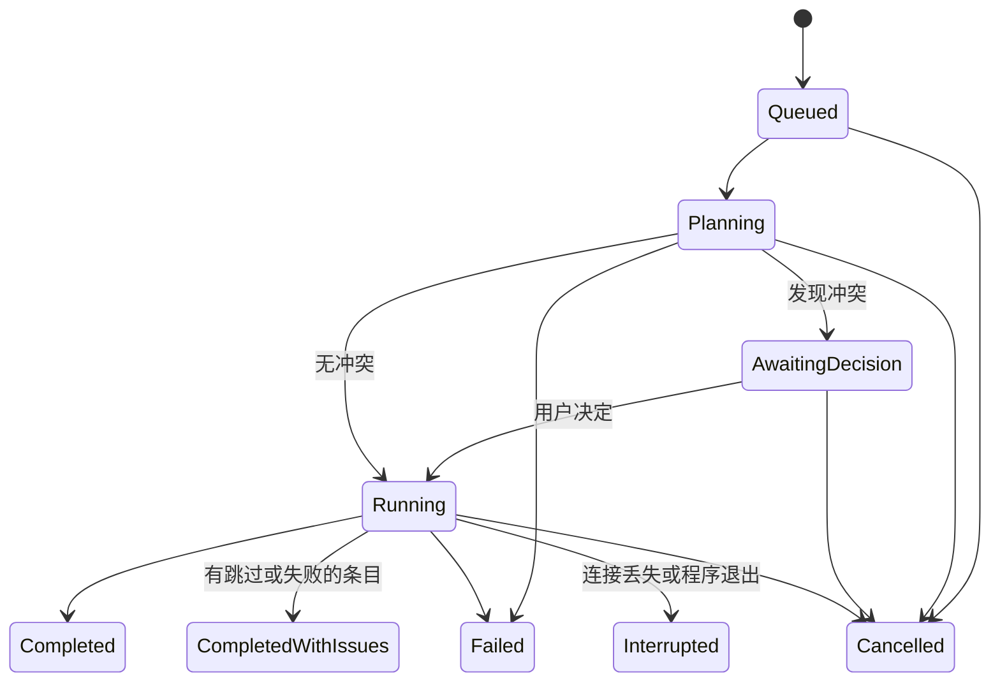

# Relay 技术架构

> 版本：0.2-draft · 2026-10-20 · 这是设计提案，不代表依赖已验证或代码已实现。
> 0.2-draft 依据对 russh 0.64.1、russh-sftp 3.0.1、vt100 0.18.1 的源码阅读修订，详见 [调研 §5](RESEARCH.md#5-依赖源码核查2026-10)。
> 初始 Cargo workspace 已按 §3 建立；当前仅实现本地只读浏览与 TUI 外壳，实际范围见 [开发指南](DEVELOPMENT.md)。下文完整接口和子系统仍为目标设计。

## 1. 架构目标与不可妥协的边界

1. SSH Shell 是**长期存在的 PTY 会话**，而非执行一次 `exec()` 后渲染输出。
2. Transfer Engine 必须与 TUI 完全解耦；后台文件复制不得阻塞界面事件循环。
3. 任意文件端点是 `(Location, Path)`，而非写死为“本地栏与远程栏”。
4. 初期依赖已有的 OpenSSH/SFTP 服务，服务器端无需安装 Relay Agent。
5. 明确区分 SSH 传输网络、SSH 身份认证以及文件传输路由。
6. 不为了跨协议兼容性牺牲 SSH/SFTP 主路径的安全和可测性。
7. **UI 事件循环永不 await 网络或磁盘 IO**；所有 IO 在服务任务中进行，通过消息通信。
8. **远端数据一律不可信**：文件名、元数据、PTY 输出、错误文本都需要校验或转义后才能使用或显示。
9. **路径无损**：内部路径以原始字节/OsString 保存，不因 UTF-8 解码而改变；只在显示层做有损转换。

## 2. 术语

| 术语 | 含义 |
| --- | --- |
| HostProfile / HostId | 一个连接配置（目标地址、端口、用户、认证、代理等）。HostId 是 Relay 内部稳定标识，**不用于** Host Key 信任匹配 |
| Location | `Local` 或 `Remote(HostId)` |
| Endpoint | `Location + Path`，任意文件的唯一描述 |
| Connection | 一条已认证的 SSH 传输连接，可承载多个 Channel |
| TerminalSession | 一个 PTY Channel 及其终端仿真状态 |
| Job | 用户一次复制操作（可能包含目录），对应 Transfers 中的一行 |
| Item | Job 规划后得到的单个文件/目录/链接操作 |
| Capabilities | 某个文件系统实际支持的能力（posix-rename、fsync、statvfs、读写块上限等） |

## 3. 模块结构

```text
relay/
├── Cargo.toml             # workspace
├── crates/
│   ├── common/      # 领域类型、路径、错误分类、FileSystem trait、LocalFs、事件
│   ├── ssh/         # 配置解析、主机信任、认证、Connection、PTY、SFTP 适配（RemoteFs）
│   ├── transfer/    # Job 规划、调度、流式管道、提交协议、校验（只依赖 common）
│   ├── tui/         # 二进制 `relay`：App 状态、输入路由、终端仿真、控件、服务编排
│   └── cli/         # 0.2 引入；届时把服务编排抽出为 app
└── tests/
    └── integration/       # Docker OpenSSH + 自建异常 SFTP 服务器 + 故障注入
```

依赖方向（单向，禁止反向）：

```text
tui ──► transfer ──► common
 │                   ▲
 └────► ssh ─────────┘
```

- `transfer` **不依赖** `ssh`：它只操作 `dyn FileSystem`，由上层通过 `FsResolver`（`Location → Arc<dyn FileSystem>`）注入。这样传输引擎可以用内存文件系统做单元测试，也能复用到 CLI。
- 服务编排（SessionManager、TransferScheduler 的创建与连线、Prompt 路由）在 MVP 阶段放在 `tui::services` 模块，**该模块不得依赖 ratatui**，以便 0.2 平移到 `app`。
- 首期不引入动态插件、远端守护进程及事件溯源系统。

### 3.1 依赖候选

| 模块 | 技术 | 理由 / 待验证点 |
| --- | --- | --- |
| TUI | Ratatui 0.30 + Crossterm 0.29 | 渲染、输入、resize；评估 kitty keyboard 增强协议 |
| Async | Tokio | SSH、文件 IO、任务队列；取消用 `tokio_util::sync::CancellationToken` |
| SSH | russh 0.64（Apache-2.0，MSRV 1.89） | PTY、多 Channel、Agent（Unix socket / Pageant / Windows 命名管道）；加密后端 aws-lc-rs 与 ring 二选一（见 §13） |
| SFTP | **优先自研精简 SFTP v3**：P0 验证后定案，改造 russh-sftp 3.0.1 为备选 | russh-sftp 以 `String` 表示路径并对非 UTF-8 文件名做有损解码，缺少 posix-rename，见 §6.3 |
| 主机信任 | **自研** known_hosts 模块 | russh 自带实现不支持通配符、`@revoked`、全局文件等，见 §5.3 |
| 终端仿真 | vt100 0.18 + 自有 Ratatui 单元格渲染（P0-02 已定案） | vt100 暴露 DECCKM / 括号粘贴 / 备用屏幕模式；补充 DA/DSR 应答与宽字符边界裁剪，不引入绑定旧版 vt100 0.16 的 tui-term |
| SSH 配置 | 优先 `ssh -G`；后备 ssh2-config 0.8 | 见 §5.1 |
| 配置序列化 | Serde + TOML | 偏好、快捷键、保存的主机 |
| 目录约定 | `directories` | 各平台配置/状态目录 |
| 日志 | tracing + tracing-appender | 只写文件，绝不写 stdout（stdout 是 TUI） |
| 密钥内存 | zeroize / secrecy | 密码、口令短期驻留并在用后清零 |
| Errors | thiserror（库） / anyhow（二进制边界） | 结构化错误分类，见 §11 |
| State persistence | SQLite（Later） | 任务元数据与重启后提示 |

**依赖版本不要直接按本文照抄。** 在创建 `Cargo.lock` 时确认 MSRV、维护状态及许可证（以上候选均为 MIT / Apache-2.0）。

## 4. 运行时与事件模型

```text
               ┌──────────────────────── tui ─────────────────────────────┐
 crossterm ──► │ Input Router ─► Action ─► reduce(AppState) ─► render()   │
 EventStream   │      ▲                         │ Effect                   │
               │      │ AppEvent (bounded mpsc) ▼                          │
               └──────┼─────────────── Command (mpsc) ────────────────────┘
                      │                         │
        ┌─────────────┴───────┐     ┌───────────▼──────────┐     ┌────────────────┐
        │ SessionManager      │     │ TransferScheduler    │     │ Prompt Broker  │
        │ Connection / PTY    │     │ Jobs / Workers       │     │ 主机信任、密码  │
        └─────────┬───────────┘     └───────────┬──────────┘     └────────────────┘
                  │                             │
          ┌───────▼─────────────────────────────▼───────┐
          │ FsResolver → LocalFs | RemoteFs (SFTP)      │
          └─────────────────────────────────────────────┘
```

- **单一 UI 任务**：`tokio::select!` 同时等待键盘事件、`AppEvent` 和渲染节拍。状态改变只标记 dirty，渲染频率设上限（候选 ≤ 60 FPS），不因每个网络分块重绘。
- **Command / Event 分离**：UI 只发送命令（连接、打开 PTY、创建 Job、取消），服务回报事件（状态变化、进度、错误）。服务不持有任何 UI 组件。
- **进度节流**：传输进度在 Scheduler 侧合并，每个 Job 不超过约 10 次/秒推送。
- **PTY 输出不经过 AppEvent 队列逐块传递**：每个 TerminalSession 由自己的任务读取 Channel 并写入终端仿真状态（`Arc<Mutex<Parser>>`），只向 UI 发送“已更新”信号；UI 渲染时短暂加锁读取屏幕。输出洪泛时 UI 只看到最新帧。
- **Prompt Broker**：SSH 层需要用户决定时（未知主机密钥、密码、私钥口令、keyboard-interactive / 2FA），通过 `async fn prompt(PromptRequest) -> PromptResponse` 请求；TUI 实现为模态框，CLI 实现为 TTY 提问。请求可取消、可超时，未应答等同拒绝。

## 5. SSH 层

### 5.1 配置解析

1. **列出主机**：轻量解析 `~/.ssh/config`（含 `Include`）中的非通配 `Host` 别名，仅用于展示，不执行任何命令。
2. **解析有效配置**：连接时若系统存在 `ssh` 可执行文件，运行 `ssh -G <alias>` 获取 OpenSSH 计算后的最终配置（正确处理 `Include`、`Match`、`CanonicalizeHostname`、默认值）。注意 `Match exec` 会在此时执行本地命令——这是用户自己的配置，行为与直接运行 `ssh` 相同，但仅在用户主动连接时触发，并提供关闭开关。
3. **后备**：无 `ssh` 可执行文件时使用 ssh2-config 解析，遇到 `Match` 等无法确定语义的指令时提示“配置可能不完整”。

MVP 支持的指令与处理方式：

| 指令 | MVP 处理 |
| --- | --- |
| HostName / User / Port / ConnectTimeout | 支持 |
| IdentityFile / IdentitiesOnly / IdentityAgent | 支持（Agent 优先，随后按顺序尝试密钥文件） |
| ServerAliveInterval / ServerAliveCountMax | 支持（映射为 keepalive） |
| UserKnownHostsFile / GlobalKnownHostsFile / HostKeyAlias | 支持，参与 §5.3 信任查找 |
| StrictHostKeyChecking | 只能**加强**：`yes` 时未知主机直接拒绝；`no` / `accept-new` 不被采纳，按“询问”处理并提示 |
| ProxyJump | 0.2（russh `direct-tcpip` Channel 实现，跳板机同样执行完整主机校验）；MVP 明确提示“不支持” |
| ProxyCommand / LocalCommand / PermitLocalCommand | 不执行；提示“不支持”，不静默忽略 |
| ForwardAgent | 默认忽略，仅在 Relay 中对该主机显式启用后生效（见 SECURITY） |
| CertificateFile、硬件密钥（sk-*） | 0.2 评估 |

无法支持的指令必须在主机详情中可见，不能“看起来连上了另一台机器”。

### 5.2 认证

顺序：SSH Agent → 配置的密钥文件（加密私钥通过 Prompt Broker 询问口令）→ keyboard-interactive → password。失败信息记录尝试过的方法（不含秘密）。密码/口令用 `secrecy` 持有，认证完成即丢弃；不写盘。

### 5.3 主机密钥信任（自研模块）

russh 自带的 known_hosts 函数仅支持精确主机名与哈希条目，不支持通配符/否定模式、`@revoked`、`@cert-authority`、全局文件，按单个空格切分字段，且“不同算法的已知密钥”被当作“未知主机”。因此 Relay 自行实现 `ssh::trust`：

- **查找键**：`HostKeyAlias`（若配置）或实际连接的主机名，加端口（非 22 时为 `[host]:port`）；与 HostId 无关。
- **读取来源**：`UserKnownHostsFile`（默认 `~/.ssh/known_hosts`、`known_hosts2`）、`GlobalKnownHostsFile`（默认 `/etc/ssh/ssh_known_hosts`）、Relay 信任库。支持哈希、通配符、否定、制表符分隔。
- **判定**：合并所有读取来源后判断；任一来源的撤销或同算法密钥冲突均优先拒绝，不能被 Relay 信任库中的匹配记录绕过。
  - 命中 `@revoked` → 拒绝（fail-closed）；
  - 同算法密钥匹配 → 信任；
  - 同算法密钥不匹配 → `HostKeyChanged`，拒绝；
  - 只有其他算法的已知密钥 → 视为高风险，展示已知算法并要求显式确认，不按“首次连接”处理；
  - 无记录 → 展示 SHA-256 指纹，用户确认后写入。
- **算法协商**：已有已知密钥时，优先协商这些算法（与 OpenSSH 一致），减少误报。
- **写入位置**：默认写入 Relay 自有信任库（`<config>/relay/known_hosts`，OpenSSH 格式，0600）；可配置为写入 `~/.ssh/known_hosts`。从不修改或删除已有条目。（ADR-015）
- `@cert-authority`：MVP 不据此建立信任（仍按逐主机确认处理），并记录提示。

**P0-01 实现状态（2026-10-21）**：上述逐主机信任规则已在 `ssh::trust` 实现。
未知密钥及私钥口令通过 `ssh::prompt` 的有界队列/独立回复通道请求；未回复、拒绝、超时与取消
不会继续认证。信任写入在文件锁内重新合并来源，只追加；读取错误及畸形记录均拒绝连接。
原型仅实现 OpenSSH 私钥认证，使用独立示例验证，TUI 与 SessionManager 后续接入。
配置解析接收显式文件（`ssh -F` 语义），后备模式需明确选择且只支持简单 Host 块；
复杂语义、未解析路径 token、代理、证书及 KRL 撤销文件等尚不支持时明确拒绝。

### 5.4 连接与 Channel 模型

默认**每个 HostProfile 一条已认证的 Connection**，承载多个 Channel：

- N 个 PTY Channel（终端 Tab）；
- 1 个用于浏览的 SFTP Channel；
- 传输用 SFTP Channel（按 per-host 并发上限）。

理由：密码、keyboard-interactive、2FA 主机若为传输另建连接，会再次弹出认证；SSH 自带按 Channel 的流控窗口，可以限制单个 Channel 占用。

P0 必须测量“单连接上大文件传输时的终端回显延迟”。若不可接受，增加**独立传输连接**选项，但只在认证可无交互完成（Agent / 无口令密钥）或用户明确同意再次认证时自动启用。

断线语义：连接丢失后所有 Channel 进入 Disconnected，PTY 屏幕冻结并显示原因；重连会建立**新** Shell，不宣称恢复原 PTY 状态（持久会话需要远端 tmux 等）。

## 6. 文件系统层

### 6.1 路径类型

```rust
pub struct HostId(String);                 // 例如 "ssh:prod" 或 "saved:7f3a…"

pub enum Location { Local, Remote(HostId) }

/// 远端 POSIX 路径：原始字节，'/' 分隔，不做 UTF-8 假设
pub struct RemotePath(Vec<u8>);

pub enum FsPath {
    Local(std::path::PathBuf),             // 遵循本机平台规则
    Remote(RemotePath),
}

pub struct Endpoint { pub location: Location, pub path: FsPath }
```

显示时统一经过 `display_name()`：有损 UTF-8 转换 + 控制字符转义（如 `\x1b` 显示为 `␛` 或 `\e`）。

### 6.2 FileSystem trait

```rust
#[async_trait]
pub trait FileSystem: Send + Sync {
    fn location(&self) -> &Location;
    fn capabilities(&self) -> &Capabilities;

    async fn read_dir(&self, p: &FsPath, sink: DirSink) -> FsResult<()>; // 分批返回，可取消
    async fn lstat(&self, p: &FsPath) -> FsResult<Metadata>;
    async fn stat(&self, p: &FsPath) -> FsResult<Metadata>;
    async fn canonicalize(&self, p: &FsPath) -> FsResult<FsPath>;
    async fn create_dir(&self, p: &FsPath, mode: u32) -> FsResult<()>;
    async fn remove_file(&self, p: &FsPath) -> FsResult<()>;
    async fn remove_dir(&self, p: &FsPath) -> FsResult<()>;
    async fn rename(&self, from: &FsPath, to: &FsPath, mode: RenameMode) -> FsResult<()>;
    async fn open_read(&self, p: &FsPath) -> FsResult<Box<dyn FileReader>>;
    async fn open_write(&self, p: &FsPath, opts: WriteOptions) -> FsResult<Box<dyn FileWriter>>;
    async fn set_metadata(&self, p: &FsPath, m: &MetadataPatch) -> FsResult<()>;
    async fn free_space(&self, p: &FsPath) -> FsResult<Option<u64>>; // statvfs，可不支持
}

pub enum RenameMode { NoReplace, AtomicReplace }

pub struct WriteOptions { pub create_new: bool, pub mode: u32 }

#[async_trait]
pub trait FileWriter: Send {
    async fn write_all(&mut self, buf: &[u8]) -> FsResult<()>;
    async fn sync(&mut self) -> FsResult<SyncOutcome>;   // Synced | Unsupported
    async fn close(self: Box<Self>) -> FsResult<()>;
}
```

- `RenameMode::AtomicReplace` 不受支持时**返回 Unsupported**，不得退化为“先删后改名”。
- `read_dir` 使用 lstat 语义，返回条目类型（文件/目录/符号链接/特殊文件），并**丢弃** `.`、`..`、空名以及含 `/` 或 NUL 的名字（恶意服务器防护）。
- 同一 Host 上的复制在 MVP 中同样走流式管道（下载 + 上传经过本机），正确性优先；服务端 `copy-data` 扩展留到 Later。

### 6.3 SFTP 客户端选型（P0 决策点）

russh-sftp 3.0.1 源码核查结论：

| 方面 | 现状 | 对 Relay 的影响 |
| --- | --- | --- |
| 路径/文件名 | `String`，非 UTF-8 字节用 `from_utf8_lossy` 替换为 U+FFFD | 文件名被无声改写，后续操作可能失败或命中**另一个**文件 |
| 读流水线 | 支持多个未完成读请求 | 吞吐可用 |
| 扩展 | limits、fsync、hardlink、statvfs、expand-path；**无 posix-rename** | 可通过原始 `extended()` 自行发送 |

**已确认方向（2026-10-20）**：优先自研精简 SFTP v3 原型，复用 russh 的 SSH 层；最终采用与否由 P0 Gate 决定，不同时开发两套完整客户端。

- **首选：自研精简 SFTP v3 客户端**（在 russh Channel 之上，约 20 种消息）：路径为字节；自控请求流水线与内存上限；按需实现 posix-rename / fsync / limits / statvfs。
- **备选：向 russh-sftp 贡献字节路径 API**（或维护补丁分支），短期借用其实现。

自研范围限制为 MVP 必需操作及扩展。P0 验证非 UTF-8 文件名往返、1 GiB 吞吐与峰值内存、posix-rename 覆盖，并覆盖取消、断线、异常响应和原子覆盖失败；验证失败时先评估修复成本，无法可靠满足安全与资源约束则重新评估改造 russh-sftp。**无论选哪种，在字节路径可用之前：名称含 U+FFFD 的远程条目一律标记为“名称无法安全表示”，禁止对其执行任何写、删、改名、复制操作。**

### 6.4 跨平台文件名映射

远端名称写入本机时（尤其 Windows）：拒绝保留名（`CON`、`NUL`、`COM1` 等）、非法字符（`<>:"\|?*`）、结尾的点或空格；目标文件系统大小写不敏感时检测同名冲突。MVP 对这些条目**拒绝并报告**，不自动改名。

## 7. 传输引擎

### 7.1 Job 与 Item 生命周期



Item 状态：Pending → Transferring → Verifying → Committing → Done；或 Skipped / Failed / Cancelled。

- **Planning**：在源端遍历目录树（不跟随目录符号链接），在目标端 lstat 检查冲突，生成不可变的 Item 列表与总字节数。大目录分批扫描，可取消。
- **冲突在 Planning 阶段一次性决定**（逐项，或“应用到全部”：覆盖 / 跳过 / 取消）。运行期间不再弹窗阻塞；若提交时出现新冲突（目标在传输期间被创建），该 Item 失败并说明原因。
- **Retry**：对 Failed / Interrupted 的 Job 重新执行 Planning 后从头传输（MVP 不续传）。不会静默自动重试任何写操作。

### 7.2 流式管道与内存上限

```text
FileReader ──► 有界通道（K 个块） ──► FileWriter
（最多 R 个未完成读请求）              （最多 W 个未完成写请求）
```

单个 Item 内存上限约为 `(R + K + W) × chunk`；chunk 取 `min(配置值, 服务器 limits)`，候选 32–256 KiB，以 P0 压测为准。所有参数有固定上限，与文件大小无关。

并发：全局并行 Item 上限、每个 Host 并行 Item 上限（均可配置，默认值由 P0 基线确定）。

目标独占：调度器以 `(Location, canonicalize(父目录) + 名称)` 为键对目标加锁；同一目标的第二个 Job 在 Planning 阶段报告冲突。

### 7.3 提交协议

1. **临时文件**：与目标同目录，命名 `.<name>.relay-<job短ID>.part`，以 `create_new` + `0600` 创建。
2. **流式写入**完成后，`sync()`：本机 `sync_all`；远端在支持 `fsync@openssh.com` 时调用，不支持则记录为“未确认落盘”。
3. **Basic 校验**：写入字节数 = 读取字节数 = 源文件开始时大小；结束时重新 stat 源文件，大小或 mtime 变化则该 Item **失败**（“源文件在传输期间变化”）。
4. **设置元数据**（在临时文件上）：权限位去掉 setuid/setgid/sticky 后保留；保留 mtime；不保留属主。失败按策略报告为警告。
5. **提交**：
   - 目标不存在 → `rename(NoReplace)`。SFTP v3 规定目标存在时 rename 失败，这同时提供了 TOCTOU 保护（OpenSSH 服务端通过 link+unlink 实现）。
   - 用户选择覆盖 → `rename(AtomicReplace)`：远端需要 `posix-rename@openssh.com`；本机 Unix 使用 `rename(2)`，Windows 使用 `MoveFileExW(REPLACE_EXISTING)`。
   - 远端不支持原子替换 → **MVP 拒绝覆盖**并说明原因（不先删除旧文件）。
6. 提交成功后 Item 才变为 Done；取消或失败时尽力删除临时文件，删除失败则在报告中列出残留路径。

### 7.4 链接与特殊文件（MVP 默认）

- 用户**直接选中**的符号链接（指向文件）：复制其目标内容；
- 目录遍历中遇到的符号链接（文件或目录）：跳过并在报告中列出；
- FIFO、设备、套接字：跳过并报告；
- 硬链接：作为独立文件复制；稀疏文件：不保留空洞。

已存在的同名目标目录：合并写入需要在 Planning 时确认，文件级冲突逐项处理。

### 7.5 完整性级别

| 级别 | 含义 | 阶段 |
| --- | --- | --- |
| Basic | 写入完成 + 字节计数一致 + 源未变化 + 目标大小一致；**不是**密码学保证 | MVP |
| Strong | 双方计算并比较散列（远端需读回或执行命令，额外 IO，需用户开启） | 0.2 |

元数据保留是独立维度，结果单独报告。UI 只显示实际执行过的级别。

### 7.6 后台语义与退出

MVP 的“后台”指 **Relay 运行期间任务与终端并行执行**。退出时若有活动任务，需确认；确认后所有 Job 标记 Interrupted，在限定时间内尽力清理临时文件。程序退出后继续传输需要常驻进程，不纳入计划；未清理的 `.relay-*.part` 文件可通过名称识别。

## 8. 终端子系统

```text
keyboard ──► Input Router ──► Input Encoder ──► PTY Channel（Terminal Input 模式）
                    └──────► UI Action（Relay Control / 文本输入 / 模态框）
PTY 输出 ──► 终端仿真（vt100）──► 屏幕状态 ──► tui-term 渲染
                    ├──► 查询应答（DA / DSR）──► PTY Channel
                    └──► 回调：标题、响铃、OSC 52 ──► 安全策略
窗口变化 ──► 防抖 ──► SSH window-change + 布局
```

- **PTY 请求**：`TERM=xterm-256color`，初始尺寸取面板大小。不依赖 `env` 请求（服务端通常 `AcceptEnv` 受限）。
- **Input Encoder**（P0 重点，原设计缺失）：crossterm 给出的是**已解析的按键事件**，必须重新编码为远端期望的字节序列。编码依赖远端当前模式（vt100 提供：application cursor / application keypad / bracketed paste / mouse 模式）：
  - 方向键在 DECCKM 下发送 `ESC O A`，否则 `ESC [ A`；修饰键按 xterm 规则（如 `ESC [1;5A`）；
  - Alt+键 → `ESC` 前缀；Ctrl+字母 → 控制字符；
  - 粘贴：远端启用括号粘贴时用 `ESC[200~ … ESC[201~` 包裹，并**剔除内容中的 `ESC[201~`**（防粘贴注入）；
  - 鼠标：MVP 不转发给远端（鼠标归 Relay），0.2 按远端鼠标模式转发。
- **外层终端增强**：在支持时启用 crossterm 的 kitty keyboard 增强以区分 `Esc`/`Alt` 等组合；发送到远端时仍编码为 legacy xterm 序列。
- **查询应答**：vt100 不应答设备查询。通过 `unhandled_csi` 回调实现 DA1（`CSI c`）、DSR（`CSI 5n` / `CSI 6n` 光标位置）等最小集合，应答只写回该 PTY。
- **安全策略**：OSC 0/2 标题清洗控制字符后显示在 Tab 上；OSC 52 写剪贴板默认拒绝（可配置为“允许并提示”），读剪贴板始终拒绝；OSC 8 只显示文本；响铃显示为 Tab 标记。
- **资源上限**：滚动缓冲默认上限（候选 10 000 行，可配置）；输出洪泛时持续读取并解析，渲染受帧率上限约束。
- **备选与 P0-02 结论（2026-10-21）**：`vt100 0.18.1` 配合 `Responder`（应答 DA1 `CSI c`、DA2 `CSI > c`、DSR `CSI 5n`、CPR `CSI 6n` / `CSI ? 6n`、XTWINOPS `CSI 18t`，单批应答设 4 KiB 上限）与自有 Ratatui `Buffer` 渲染器，已在真实 OpenSSH 容器中通过 `vim`、`htop`、`tmux`、`less`、CJK 宽字符与 24-bit 真彩色交互测试，保真度满足 0.1 需求，不切换 `alacritty_terminal`（ADR-018）。

## 9. TUI 结构

- **状态模型**：`AppState`（工作空间、面板、对话框、主机/会话/任务的只读视图）+ `Action` + `reduce()` + `Effect`（发给服务的命令）。渲染为纯函数 `render(&AppState, &Shared)`，可用 Ratatui `TestBackend` 测试。
- **输入模式**（Input Router 依此分发，详见 [UX §3](UX.md#3-输入模式与快捷键)）：
  - `Control`：Relay 快捷键生效；
  - `TerminalInput`：除逃逸键外全部交给 Input Encoder；
  - `TextInput`：过滤框、重命名、表单，字符进入文本框；
  - `Modal`：确认框、Prompt Broker 请求，只响应框内按键。
- 四个工作空间：Hosts、Files、Terminals、Transfers（与 UX 一致）。

## 10. 配置与本地存储

| 路径（Linux 示例） | 内容 | 权限 |
| --- | --- | --- |
| `~/.config/relay/config.toml` | 偏好、快捷键（含逃逸键）、并发与缓冲参数、OSC 策略 | 0600 |
| `~/.config/relay/hosts.toml` | Relay 保存的 HostProfile（不含密码） | 0600 |
| `~/.config/relay/known_hosts` | Relay 信任库（OpenSSH 格式） | 0600 |
| `~/.local/state/relay/logs/` | 结构化日志（脱敏、按大小轮转） | 0700 目录 |

HostId 命名空间：`ssh:<alias>`（来自 SSH 配置，只读）与 `saved:<uuid>`（Relay 保存）。同名时两者并列展示并标注来源，不合并。密码不持久化；OS Keychain 存储留到 Later。

## 11. 错误分类

```text
ConnectError: DnsFailed | Refused | Timeout | NoRoute | ProxyUnsupported
              | HostKeyUnknown | HostKeyChanged | HostKeyRevoked
              | AuthFailed { tried: Vec<Method> } | ProtocolError
FsError:      NotFound | PermissionDenied | AlreadyExists | NoSpace | Unsupported
              | UnsafeName | ConnectionLost | Failure { server_message } | Io
```

SFTP v3 状态码很粗（没有“磁盘已满”），远端写失败多为通用 `FAILURE`。因此：Planning 时如服务端支持 `statvfs@openssh.com` 则预检剩余空间；错误提示附带服务端原始消息（转义后）；产品文案只承诺“尽力区分”。

## 12. Tailscale 接入

**Tailscale 是网络可达性层，不是新的文件传输协议。**

MVP 允许通过 `100.x.y.z` 等 Tailnet IP、可解析的 MagicDNS 域名，以及已配置的 Subnet Router 可达的内部目标连接——它们在 Relay 中就是普通 HostName，不需要专门代码。

前提是本机的 Tailscale 客户端和操作系统路由、ACL/grants/SSH 服务端配置已正确设置。Relay 不负责启动 VPN、修改 Tailnet 策略或绕过授权。

**必须区分两种场景**：
- Ordinary SSH over Tailscale：普通 SSH 密钥/Agent/密码认证 + Tailnet 网络。
- Tailscale SSH：Tailscale 管理 SSH 身份与授权（可能出现浏览器复核等交互），Later 单独做兼容验证。

后期可选读取本机 `tailscale status --json` 作为设备发现辅助，但“节点在线”不代表目标端口可连接，也不意味着授权成功。

Windows/WSL2：Windows 路径、WSL 路由和 DNS 需要分别验证；WSL2 内的 Relay 默认无法访问 Windows 侧 OpenSSH Agent（命名管道），需要桥接方案或在 WSL 内运行 Agent。目标是连接兼容，而不是 Relay 自动修复宿主机环境。

## 13. 构建与分发注意

- P0-01 使用 russh 0.64.1，关闭默认特性并选择 ring 0.17.14；Linux 构建已通过，WSL2/Windows 后端验证仍待完成，P0-00 此项保持未完成。
- 暂禁用 RSA 功能，不通过忽略安全公告来放行构建；当前支持 Ed25519/ECDSA，见 ADR-017。
- 使用 Rust 2024 edition；MSRV 取所有依赖的最大值（当前 russh 要求 1.89）。
- CI：fmt、clippy、test、cargo-deny（许可证与漏洞）。

## 14. 设计取舍记录（ADR 摘要）

| 决策 | 当前结论 | 原因 |
| --- | --- | --- |
| ADR-001 | 不 Fork termscp | 它以文件传输 Activity 为中心，后台队列与 PTY 需要大重构 |
| ADR-002 | 只做 SSH / SFTP | 让 MVP 规模可控 |
| ADR-003 | 传输 Core 不依赖 TUI，也不依赖 ssh | 长任务和 CLI 可复用；可用内存文件系统测试 |
| ADR-004 | 远程互传优先内存中继 | 不要求两台远端直接互通、不分发凭证 |
| ADR-005 | Tailscale 作为网络接入 | 无需自行实现 WireGuard 或额外服务 |
| ADR-006 | 主机密钥严格验证 | 避免中间人攻击及不可信连接 |
| ADR-007 | CLI 延至 0.2 | 先验证真实 PTY + 传输并行体验 |
| ADR-008 | 逃逸键可配置，默认同时启用 `F12` 与后备键 `Ctrl+]`（**已确认** 2026-10-21） | 避免与远端常用按键冲突；`F12` 被 Yakuake/Guake、macOS 媒体键拦截时可用 `Ctrl+]`（兼容传统 `0x1d`/`Ctrl+5` 与 kitty 协议），连按两次向远端透传 |
| ADR-009 | 自研 known_hosts 解析与判定 | russh 实现不支持通配符、`@revoked`、全局文件，且误判算法变化 |
| ADR-010 | 内部路径为字节；优先自研精简 SFTP v3，P0 Gate 后定案（方向已确认 2026-10-20） | 防止非 UTF-8 文件名被无声改写；改造 russh-sftp 为备选 |
| ADR-011 | 默认每主机单连接多 Channel，独立传输连接为可选项 | 避免重复认证；以 P0 延迟测量为准 |
| ADR-012 | SSH 配置优先用 `ssh -G` 解析 | 与 OpenSSH 语义一致，避免重写 Include/Match |
| ADR-013 | 冲突在 Planning 阶段决定，运行期不弹窗 | 后台任务不被交互阻塞；提交时的新冲突视为失败 |
| ADR-014 | 覆盖必须原子替换，否则 MVP 拒绝（**已确认** 2026-10-20） | 不允许“先删后写”导致旧数据丢失 |
| ADR-015 | 新信任默认写入 Relay 信任库 `<config>/relay/known_hosts`，可配置为写入 `~/.ssh/known_hosts`（**已确认** 2026-10-20） | 不修改用户的 OpenSSH 文件；同时读取两者保证一致 |
| ADR-016 | ProxyJump 保留在 0.2（已确认 2026-10-20） | 若自用核心场景或首批用户的日常连接被阻断，重新评估只提前单跳到 0.1；多跳和 ProxyCommand 仍延后 |
| ADR-017 | P0-01 暂禁用 RSA，使用 ring + Ed25519/ECDSA（2026-10-21） | cargo-deny 报告 RSA 依赖受未修复的 [RUSTSEC-2023-0071](https://rustsec.org/advisories/RUSTSEC-2023-0071) 影响；移除 rsa 特性而非忽略公告。历史 RSA known_hosts 仍用于识别算法变化；原生 RSA 支持另行评估 |
| ADR-018 | 终端仿真采用 `vt100 0.18.1` + 自有 Ratatui 渲染与 `Responder`（**已确认** 2026-10-21） | P0-02 实测 `vim`、`htop`、`tmux`、`less`、CJK 宽字符和真彩色通过；`tui-term 0.3` 锁定旧版 `vt100 0.16`，自有渲染仅数十行且可直接控制宽字符右边界裁剪与光标呈现 |

## 15. 关键待决事项

- 优先自研的精简 SFTP v3 客户端能否通过安全、异常处理和资源上限验证？未通过则重新评估改造 russh-sftp。（P0-03）
- 单连接多路复用下的终端延迟是否可接受？（P0-04）
- aws-lc-rs 与 ring 的选择（P0 构建验证）。
- 是否需要在 0.2 采用 SQLite 持久化任务元数据？

关联：[产品](PRODUCT.md) · [安全](SECURITY.md) · [交互](UX.md) · [测试](QUALITY.md)
